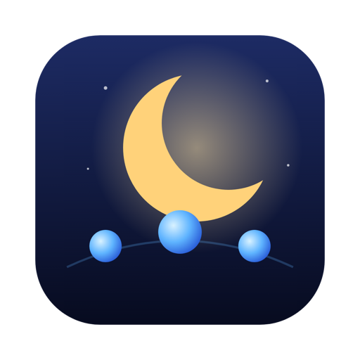

<p align="center">
  
</p>

<h1 align="center">Nightyard</h1>

<p align="center">
  <a href="https://github.com/STEIN64-BIT/nightyard/releases"></a>
  <a href="https://github.com/STEIN64-BIT/nightyard/blob/HEAD/LICENSE"></a>
  <a href="https://github.com/STEIN64-BIT/nightyard/issues"></a>
  <a href="https://github.com/STEIN64-BIT/nightyard/pulls"></a>
</p>

<p align="center">
  <strong>An IDE for AI coding agents that keeps them working while you're away.</strong><br/>
  Multiple Claude Code / Codex / Gemini / Kimi sessions, an autonomous supervisor, Sleepy for overnight runs,
  and a live graph of your agents and your Obsidian notes.
</p>

<p align="center">
  <strong>New to AI coding agents?</strong> Start with the <a href="docs/getting-started.md">Getting started guide</a>:
  from zero to your first agents in about 20 minutes.
</p>

## The setup in one picture

- **Nightyard** is the workspace: every agent session in its own terminal tab, per project, with cost and
  context tracking, a kanban board and session resume.
- **Your Obsidian vault** becomes a live graph next to your sessions. Click a note to start an agent on it.
- **Sleepy is built in.** Give it a goal and a time budget, close the laptop, and read one report in the
  morning. Nothing extra to install.
- **Wakey** keeps an interactive Claude Code session moving while you're not at the keyboard.

## Features

### Agents that keep going

- **Sleepy, built in — long unattended runs.** The `(-.-)` button (or *Plan with Sleepy* on a note) opens a pane:
  type a goal, pick a duration (30 min, 2 h, 8 h) and a mode (Opus, Codex, or the two as a team), press start.
  Sleepy plans the work, runs it in branches, and ends every run with one readable HTML report; finished runs
  are also distilled into a note in your vault (`<vault>/Sessions/`). Nightyard runs Sleepy with its own
  built-in Node, and links Sleepy's Claude Code skills into `~/.claude/plugins/sleepy` the first time
  (an existing plugin there is left alone).
- **Wakey v2 (beta) — autonomous session supervisor.** Click the ☀ button in the sidebar header, optionally type a
  direction ("get the test suite green"), and Wakey keeps the active Claude Code session moving: whenever the
  session finishes a turn or stops on a prompt, a supervisor decides what to type next and types it.
  *Beta:* Wakey v2 is new and has had little real-world mileage. Watch your first runs, keep the safety caps on,
  and please [open an issue](https://github.com/STEIN64-BIT/nightyard/issues) when it does something odd.
  - Runs in the main process and is persisted to `~/.nightyard/wakey-runs.json`: a window reload or an app
    restart resumes the run on the restored session instead of losing it.
  - One long-lived supervisor "brain" per run (Claude Agent SDK, no tools) that is fed only the *new* part of
    the transcript each turn, with a one-shot `claude -p` fallback if the SDK session cannot start.
  - Three triggers: Claude Code hook events, a watchdog for missed turns (no output for N minutes), and an
    instant fast-path for routine dialogs (folder trust, permission menus, plan approval, retry). The
    fast-path never answers a screen that mentions destructive actions (delete, force-push, `rm -rf`, …) —
    those go to the supervisor.
  - Safety caps: max iterations (default 50), at most 30 supervision cycles per rolling hour, auto-stop after
    3 consecutive errors. Wakey deliberately ignores `ANTHROPIC_API_KEY` / `ANTHROPIC_AUTH_TOKEN` and runs on
    your Claude Code login, so an unattended loop never bills an API key.
  - A status panel (bottom right, in every window) that never silently vanishes: stopped and orphaned runs stay
    visible with their reason, history, **restart** and **dismiss**; animated eyes `(o.o)` show the phase in the
    panel, the collapsed pill and the tab badge. Per-project default directions.
  - Preferences → Wakey: max iterations, watchdog minutes, supervisor model, system-prompt override.
  - Design notes: [`docs/design/wakey-v2.md`](docs/design/wakey-v2.md).

### Your agents and your notes in one graph

- **Live agent & knowledge graph.** The *All Projects* overview (⊞ in the sidebar header) shows a live graph
  of your projects, their agent sessions (colored by status: working, waiting, done), subagents and recent tool
  calls. Click it for a fullscreen graph — 2D, or 3D with a toggle — that also pulls in your notes vault:
  Markdown notes, `[[wikilinks]]`, `#tags` and folders, resolved the way Obsidian does. Click a **session**
  bubble and *Go to session* jumps straight into that terminal; click a **note** to *Launch agent here* (a new
  session seeded with the note), *Launch with Wakey* (the same, with Wakey steering it towards the note) or
  *Plan with Sleepy*. Search and a depth slider filter the graph, and it updates live as notes change on disk.
  - Works with **any Obsidian vault** (or any folder of `.md` files): set Preferences → *Knowledge vault path*
    (default `~/ObsidianVault`; `~/…` is expanded). Nothing is ever created there on its own — only finished
    Sleepy runs write a summary note into `<vault>/Sessions/`.
- **Counsel of Personalities.** A per-project *Counsel* tab (sidebar → Counsel): ask a question, three team
  members (from the Team tab) debate it over several rounds on real `claude` / `codex` CLIs, an optional moderator
  checks for convergence, and an adjudicator returns a verdict you can copy as Markdown. Seats are suggested
  from the question; each seat can run on Claude or Codex. Needs at least three team members.

### The workspace

- **Multi-session management** — run multiple agent sessions per project, each in its own PTY; use swarm mode
  for a grid view of all sessions at once and spin up new ones with `Cmd+\`.
- **Tab detach & multi-window** — drag a tab out of the window to give that session its own window; sessions keep
  running in the main process and every window stays in sync.
- **Providers & accounts** — Claude Code, Codex CLI, Gemini CLI, Kimi Code CLI (`kimi`) and Copilot CLI. Multiple
  Codex logins: every `~/.codex-<name>` directory with an `auth.json` shows up as a separate account in New Session
  and the `+` menu (`CODEX_HOME=~/.codex-work codex login` to create one).
- **Kanban task board** — plan work per project with drag-and-drop, search and tag filtering; each card can spawn
  or resume a session in one click, and tasks move to Done when their session completes.
- **Cost & context tracking** — real-time spend, token usage and context window per session, plus a session
  inspector with timeline, cost breakdown and tool usage (`Cmd+Shift+I`).
- **Session resume** — pick up where you left off, even after restarting the app.
- **Session status indicators** — colored dots on each tab (working, waiting, input needed, completed), with
  optional desktop notifications and smart alerts for missing tools, context bloat and session health.
- **AI Readiness Score** — how well-prepared a project is for AI-assisted coding, with one-click fixes.
- **Embedded browser tab** — open any URL (e.g. `localhost:3000`) in a session tab, click any element to inspect
  it, and send editing instructions with the exact selector, text and page URL as context.
- **P2P session sharing** — share a live terminal with a teammate over an encrypted peer-to-peer connection
  (WebRTC), read-only or read-write, with a PIN.
- **Light and dark themes**, a toggle in the sidebar footer, and full keyboard shortcuts.
- **Smaller things.** Sidebar project sorting by last use, global default CLI args, GPU stability flags against
  black/garbled terminal tabs, `node bin/nightyard-add.js <path> [--name X]` to add a project from the command line
  (`nightyard-add` after `npm link`), and optional extra Claude Code hooks (`npm run install-hooks`: current-time
  context + per-project memory folder bootstrap; `npm run uninstall-hooks` removes them).
- **No silent updates.** Nightyard builds have no update feed (`build.publish: null`), so a build never replaces
  itself with another one.

## Requirements

| Feature | Needs |
| --- | --- |
| Everything | git and at least one CLI: [Claude Code](https://docs.anthropic.com/en/docs/claude-code) (recommended), [Codex CLI](https://github.com/openai/codex) or [Gemini CLI](https://github.com/google-gemini/gemini-cli). From source you also need Node.js **24** (see `.nvmrc`; `nvm use`), and native build tools if `node-pty` has to be rebuilt (Xcode Command Line Tools on macOS, Visual Studio Build Tools on Windows). |
| Sleepy | Nothing extra: it ships with the app. Opus mode needs Claude Code logged in; Codex mode needs `codex` logged in. |
| Wakey v2 | Claude Code installed and **logged in** (`claude`, then `/login`; a Claude subscription — API keys in the environment are ignored on purpose). |
| Agent & knowledge graph | Nothing extra for the agent graph; for notes, an Obsidian vault (or any folder of Markdown files) set in Preferences → *Knowledge vault path*. |
| Counsel | `claude` and/or `codex` on your PATH, plus three or more team members (Team tab → add from the predefined personas). |
| Kimi provider | The Kimi Code CLI (`kimi`) on your PATH and logged in. |

Platforms: developed and used daily on macOS (Apple Silicon). The core app and Wakey also build on Windows.
Linux should work but is untested.

## Getting started on a fresh Mac

First time with coding agents? Follow the step-by-step [Getting started guide](docs/getting-started.md). The
short version:

> **Heads-up:** Nightyard runs Claude Code without permission prompts (`--dangerously-skip-permissions`), so
> agents edit files and run commands without asking. Use it on projects in git, commit before you start a task,
> and keep secrets out of project folders.

1. **Install Claude Code** (`curl -fsSL https://claude.ai/install.sh | bash`, or see the
   [docs](https://docs.anthropic.com/en/docs/claude-code)), run `claude` once and log in (`/login`). Optional:
   the [Codex CLI](https://github.com/openai/codex) (`codex login`) for Codex sessions, Sleepy's Codex mode and
   Counsel seats.
2. **Install Nightyard**: download the `.dmg` from [Releases](https://github.com/STEIN64-BIT/nightyard/releases)
   (Apple Silicon or Intel), drag Nightyard to Applications and clear the quarantine flag once — see
   [Install](#install). Or run it from source.
3. **Add your projects** with the **+** in the sidebar header (New Project).
4. **Point it at your vault**: Preferences → *Knowledge vault path* → your Obsidian vault folder
   (skip this if it lives at `~/ObsidianVault`). Open ⊞ → click the graph to see notes and sessions together.
5. **Try Sleepy**: click `(-.-)` in a project, type a goal ("tidy up the test suite"), pick 30 min, start.
   Or click a note in the graph → *Plan with Sleepy*.
6. **Try Wakey**: open a Claude session, click ☀ in the sidebar header, type a direction, press Enter.

## Install

### Download (macOS, Windows)

[Releases](https://github.com/STEIN64-BIT/nightyard/releases) carry **unsigned** builds: a `.dmg` for Apple
Silicon (`arm64`) and Intel (`x64`) Macs and an NSIS installer for Windows.

- **macOS:** open the `.dmg`, drag Nightyard to Applications, then clear the quarantine flag once (the app is not
  notarized):
  ```bash
  xattr -dr com.apple.quarantine /Applications/Nightyard.app
  ```
- **Windows:** run the installer; SmartScreen will warn about an unknown publisher (*More info → Run anyway*).

### From source

```bash
xcode-select --install     # git + compilers (macOS)
nvm install 24             # https://github.com/nvm-sh/nvm
git clone https://github.com/STEIN64-BIT/nightyard.git
cd nightyard
nvm use
npm ci
npm start                  # builds (including Sleepy), then launches the app
```

Run the tests with `npm test`.

### Build an unsigned macOS app (.dmg)

The build config has no signing identity or notarization, so build an unsigned, ad-hoc-signed `.dmg`:

```bash
npm run build
CSC_IDENTITY_AUTO_DISCOVERY=false npx electron-builder --mac dmg --arm64 \
  -c.mac.notarize=false -c.mac.identity=null
# electron-builder skips deep signing; ad-hoc re-sign the bundle so it launches
# (avoids the "Team ID mismatch" crash on first launch)
codesign --force --deep --sign - dist/mac-arm64/Nightyard.app
# repackage just the dmg from the re-signed app
CSC_IDENTITY_AUTO_DISCOVERY=false npx electron-builder --mac dmg --arm64 \
  -c.mac.notarize=false -c.mac.identity=null --prepackaged dist/mac-arm64/Nightyard.app
```

The `.dmg` lands in `dist/` (arm64 = Apple Silicon). Whoever installs it clears the quarantine flag once, as
above. `npm run deploy-local` does a local build and installs it straight into `/Applications/Nightyard.app`.
The `Release` GitHub workflow (tag `v*` or run it by hand) builds the same unsigned artifacts for macOS and
Windows and attaches them to a draft release — no secrets involved.

## Sleepy

Sleepy also lives in its own repo, [STEIN64-BIT/sleepy](https://github.com/STEIN64-BIT/sleepy), as a command-line
tool. Nightyard ships a copy of it (`vendor/sleepy/`, bundled into the app by `scripts/build-sleepy.mjs`), so you
don't need that repo to use Sleepy inside Nightyard. Install it from there if you also want `sleepy` in your
terminal; to have Nightyard run that checkout instead of the built-in copy, set Preferences → Sleepy →
*Own Sleepy CLI* to `<checkout>/cli/bin/sleepy.mjs`.

## Where things live

State lives in `~/.nightyard/` (`state.json`, `wakey-runs.json`), app data in
`~/Library/Application Support/Nightyard`, and hook data in `<tmpdir>/nightyard/`. On first start Nightyard
installs its Claude Code (and Codex/Gemini/Kimi/Copilot) hooks, marked `# nightyard-hook`, and a status-line
script. Claude Code has one `statusLine` slot: if another tool already owns it, Nightyard asks before taking it
over and remembers your answer.

## Contributing

PRs welcome! See the [Contributing Guide](CONTRIBUTING.md) and [Code of Conduct](CODE_OF_CONDUCT.md).

## License

[MIT](LICENSE).

<p align="center">
  <sub>Nightyard is an independent project and is not affiliated with or endorsed by Anthropic.</sub>
</p>
